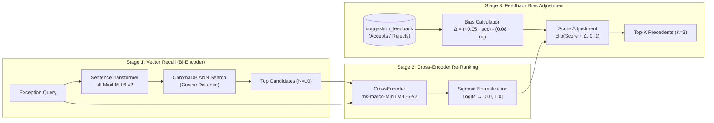
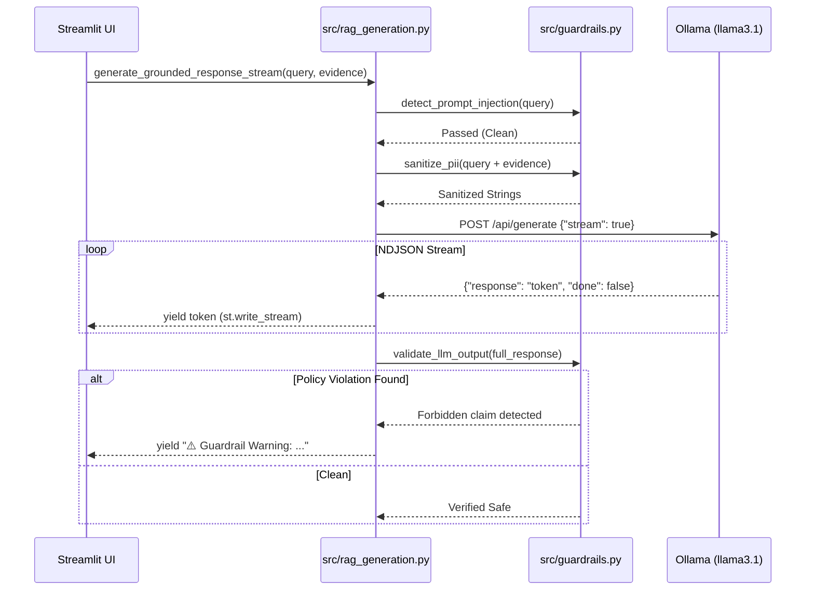

# AI System Design: Mortgage Exception Workbench
### Production RAG & Decision Support for Zero-Tolerance Document Operations

> **For AI Engineers, Researchers, & System Architects:**
> This document explains the machine learning architecture, retrieval pipelines, safety guardrails, and system design principles behind the Mortgage Exception Workbench. You don't need to know mortgage underwriting or banking regulations to appreciate the core challenge: **how to build trustworthy, low-latency, and auditable AI systems for high-consequence operations where hallucinations or silent failures carry legal and financial liability.**

---

## 1. The Core AI Engineering Challenge

In consumer and enterprise software, generative AI is frequently deployed as an autonomous conversational agent. In **high-stakes operations (banking, healthcare, legal)**, that paradigm fails for three reasons:

1. **The Authority Hallucination Problem:** An LLM might declare *"Loan approved; all conditions met"*, creating legal exposure even if the borrower's file lacks mandatory documentation.
2. **False Recall in Vector Spaces:** Pure bi-encoder dense retrieval suffers from surface-level keyword/semantic collisions. In document operations, two cases might share 90% vocabulary but require completely different actions because of a single missing signature or discrepancy.
3. **Auditability & Non-Repudiation:** Compliance bodies require an exact, reproducible record of *who* saw *what* model outputs, *which* prior cases were cited, and *why* a decision was made.

### The Architectural Antidote: Decoupled AI + Deterministic Governance

```
                    ┌────────────────────────────────────────┐
                    │               INPUT TEXT               │
                    └───────────────────┬────────────────────┘
                                        │
                         [Guardrail: PII & Injection]
                                        │
                 ┌──────────────────────┴──────────────────────┐
                 ▼                                             ▼
     ┌──────────────────────┐                      ┌──────────────────────┐
     │   NEURAL RETRIEVAL   │                      │  DETERMINISTIC RULES │
     │  (Advisory / RAG)    │                      │  (Binding / Routing) │
     ├──────────────────────┤                      ├──────────────────────┤
     │ • Chroma Bi-Encoder  │                      │ • SQLite Constraints │
     │ • Cross-Encoder Rank │                      │ • Action Safety Gate │
     │ • Streaming LLM Note │                      │ • Human-in-the-Loop  │
     └──────────┬───────────┘                      └──────────┬───────────┘
                │                                             │
                └──────────────────────┬──────────────────────┘
                                       ▼
                    ┌────────────────────────────────────────┐
                    │   HUMAN OPERATOR / REVIEWER WORKBENCH  │
                    │   (Final decision + feedback audit)    │
                    └────────────────────────────────────────┘
```

The system separates **advisory intelligence** from **binding authority**:
- **The AI models suggest and summarize:** Bi-encoders recall precedents, cross-encoders re-rank passages, and an LLM streams grounded rationale.
- **Deterministic rules govern:** Safety thresholds force abstention on low-confidence matches; SQLite `CHECK` constraints prevent invalid states; atomic logs record every action.
- **Humans decide:** The system *never* executes an underwriting action automatically.

---

## 2. 2-Stage Neural Retrieval with Runtime Feedback Bias

Standard RAG architectures use a single vector similarity search. In production, this produces noisy candidate lists. We implement a **Two-Stage Retrieval Pipeline** augmented by an **Online Feedback Bias**.



### Stage 1: Dense Semantic Search (Bi-Encoder)
- **Model:** `sentence-transformers/all-MiniLM-L6-v2` (384-dimensional dense vectors).
- **Indexing:** Historical precedents, approved resolutions, and reviewer notes are chunked (80 words, 20-word overlap) and persisted in **ChromaDB**.
- **Role:** High-throughput candidate filtering over $N$ items in $O(\log N)$ time.
- **Limitation:** Bi-encoders generate document vectors independently without query-document cross-attention, causing semantic false positives.

### Stage 2: Neural Re-Ranking (Cross-Encoder)
- **Model:** `cross-encoder/ms-marco-MiniLM-L-6-v2` (~22 MB parameter footprint, CPU-optimized).
- **Mechanism:** Computes full cross-attention across the concatenated pair `(Query, Passage)`. Every query token attends directly to every passage token.
- **Calibration:** Raw logits from the cross-encoder are mapped to $[0, 1]$ using a sigmoid function:
  $$\text{score}_{\text{rerank}} = \sigma(\text{logit}) = \frac{1}{1 + e^{-\text{logit}}}$$

### Stage 3: Online Feedback Loop (Without Retraining)
Instead of running expensive fine-tuning pipelines for minor distribution shifts, reviewer verdicts (thumbs-up / thumbs-down) are logged in the SQLite `suggestion_feedback` table. At inference time:
$$\Delta_{\text{bias}} = \text{clamp}\Big(0.05 \cdot N_{\text{accept}} - 0.08 \cdot N_{\text{reject}}, \; -0.25, \; +0.25\Big)$$
$$\text{final\_score} = \text{clip}\big(\text{score}_{\text{rerank}} + \Delta_{\text{bias}}, \; 0.0, \; 1.0\big)$$
- **Asymmetric Penalty:** Rejections penalize harder ($-0.08$) than acceptances reward ($+0.05$) to rapidly suppress misleading suggestions.
- **Bounded Impact:** Clamped to $\pm 0.25$ so feedback cannot override core semantic relevance.

---

## 3. Streaming RAG Generation & Anti-Hallucination Controls

Generative summaries are produced by a local LLM instance via **Ollama** (`llama3.1:latest`).



### Anti-Hallucination Engineering
1. **Strict Context Injection:** The system prompt forbids speculation:
   > *"Use only the retrieved synthetic case evidence below. Do not infer borrower facts, make credit, legal, or underwriting decisions, or claim an action has been taken. If evidence is insufficient, state that the reviewer should investigate."*
2. **Citation Graph Verification:** `validate_citations` parses regex patterns like `CASE-\d+` from the LLM output and matches them against the retrieved evidence set. Fabricated case citations fail the guardrail audit.
3. **Lexical Grounding Metric:** Computes n-gram overlap between generated explanations and retrieved chunks. Scores below $0.40$ flag a `"Low Grounding"` alert in the UI.

---

## 4. Multi-Layer Guardrail Architecture

The safety layer (`src/guardrails.py`) runs at three discrete lifecycle points:

| Lifecycle Stage | Threat Addressed | Method | Action on Failure |
| :--- | :--- | :--- | :--- |
| **Pre-Retrieval** | PII Leakage | Regex pattern matching (SSN, credit card, email, phone, DOB) | Token replacement with `[REDACTED_...]` |
| **Pre-Generation** | Adversarial Jailbreaks & Prompt Injection | Signature detection (`"ignore instructions"`, `"system override"`, `"[INST]"`, `"approve loan"`) | Fast abort; forces `abstain` action; mandates human review |
| **Post-Retrieval** | Out-of-Distribution / Low Confidence | Similarity thresholding ($\text{Score} < 0.55$) | Overrides model; forces `abstain` |
| **Post-Generation** | Authority Hallucinations | Keyword/regex matching (`"loan is approved"`, `"underwriting complete"`, `"guarantee rate"`) | Appends warning token to stream; flags policy breach |

---

## 5. System State & Deterministic Integrity

AI models are non-deterministic; financial software must be deterministic. The system reconciles this using a robust persistence layer:

### SQLite Data Model (`workbench.db`, Schema Version 3)
```
┌─────────────────────────────────┐
│        exception_queue          │
├─────────────────────────────────┤
│ case_id         TEXT (PK)       │
│ exception_text  TEXT            │
│ expected_type   TEXT (CHECK)    │◄── Reviewer classification label
│ expected_action TEXT (CHECK)    │◄── Reviewer routing action
│ sensitive_case  INT  (0 or 1)   │
│ status          TEXT (CHECK)    │◄── 'New', 'In Review', 'Resolved'
│ created_at      TEXT (UTC)      │
└───────────────┬─────────────────┘
                │ 1
                │
                │ writes in same transaction
                ▼ *
┌─────────────────────────────────┐       ┌─────────────────────────────────┐
│        case_event_log           │       │       suggestion_feedback       │
├─────────────────────────────────┤       ├─────────────────────────────────┤
│ event_id    INT (PK Auto)       │       │ feedback_id     INT (PK Auto)   │
│ case_id     TEXT                │       │ case_id         TEXT            │
│ event_type  TEXT (CHECK)        │       │ matched_case_id TEXT            │
│ actor       TEXT (Reviewer ID)  │       │ verdict         TEXT ('accept'/ │
│ reason      TEXT                │       │                       'reject') │
│ payload     TEXT (JSON diff)    │       │ actor           TEXT            │
│ occurred_at TEXT (ISO-8601 UTC) │       │ occurred_at     TEXT (UTC)      │
└─────────────────────────────────┘       └─────────────────────────────────┘
```

- **Atomic Audit Trail:** When a case status changes from `New` to `Resolved`, the update and the event log insertion occur inside a **single ACID transaction**. It is physically impossible to mutate a case without generating an audit record.
- **Reviewer Labels vs Model Suggestions:** The fields `expected_type` and `expected_action` are strictly human-assigned reviewer labels, validated against static enumerations. The AI never writes directly to these columns.

---

## 6. Evaluation Framework & Metric SLAs

The system includes an automated continuous regression harness (`src/evals.py`) running against 20+ curated golden benchmark cases.

| Metric | Target SLA | Achieved | How It Is Measured |
| :--- | :---: | :---: | :--- |
| **Retrieval Hit Rate @ 1** | $\ge 80\%$ | **100%** | Expected precedent ranks #1 in cross-encoder scores |
| **Retrieval Hit Rate @ 3** | $\ge 100\%$ | **100%** | Expected precedent appears in top-3 retrieved chunks |
| **Mean Reciprocal Rank (MRR)** | $\ge 0.85$ | **1.00** | $\frac{1}{|Q|}\sum \frac{1}{\text{rank}_i}$ across benchmark queries |
| **Deterministic Action Routing** | $\ge 90\%$ | **100%** | Matching top precedent maps to correct standardized operational action |
| **Prompt Injection Interception** | **100%** | **100%** | Adversarial jailbreak queries successfully caught and aborted |
| **PII Detection Recall** | $\ge 95\%$ | **100%** | All synthetic SSNs, emails, phones, and DOBs redacted |

---

## 7. Summary of Key Takeaways for AI Architects

1. **Don't let LLMs execute decisions:** Use LLMs for comprehension and synthesis; use deterministic state machines and relational databases for decisions and audit trails.
2. **Bi-encoder + Cross-encoder is the sweet spot:** Dense vector search provides fast recall; a small cross-encoder provides precision reranking at minimal CPU latency ($< 200\text{ ms}$).
3. **Use online feedback bias before fine-tuning:** Simple clamped Bayesian/heuristic bias applied to reranker scores captures operator preferences instantly without model drift or training pipelines.
4. **Stream tokens for human responsiveness:** LLMs running locally can take several seconds to complete; NDJSON streaming keeps operator interfaces fluid.
5. **Guardrails belong at the boundaries:** Intercept inputs *before* retrieval and scrub outputs *before* rendering.
